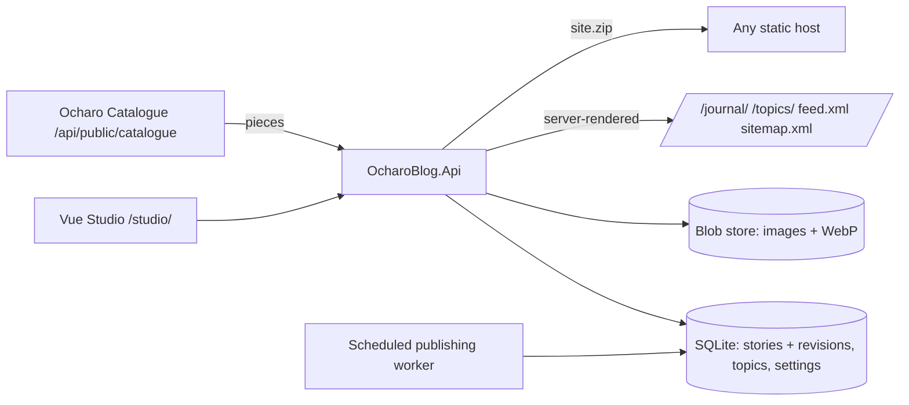

# ventures.ocharo-blog — Architecture

*Last updated: 2026-10-18*

| Project | Responsibility |
|---|---|
| `OcharoBlog.Api` | Admin API (`/api/blog/*`), public site + preview controllers, Studio SPA fallback (`/studio/{**path:nonfile}`), local-pilot boundary |
| `OcharoBlog.Application` | `ArticleService` (validation, lifecycle, `PublishDueAsync`, revisions), `TopicService`, `SiteSettingsService`, `SiteRenderer` (encoded HTML, RSS, sitemap, robots), `SiteService` (live pages, preview, export) |
| `OcharoBlog.Infrastructure` | `MediaStore`, `CatalogueFeed` (60 s cache, degrades to empty), `BrandKit` (60 s cache, degrades to site settings), `ScheduledPublishingWorker`, `BlogSeeder` |
| `OcharoBlog.Persistence` | EF Core SQLite, revision checks in a transaction, unique slugs |

## Brand

- `Blog:BrandBaseUrl` (dev `http://localhost:8287`) points at Ocharo Brand. When its public kit answers, the published on-light logo is copied into the blog media store by SHA-256 and replaces the settings logo, and the brand links replace the footer links — on live pages, previews and the static export alike.
- An active brand appearance with a link adds an event badge beside the logo on live pages and previews (the logo still links home); static exports leave it out because they cannot expire.
- Unreachable or unconfigured Brand service → the blog's own settings apply. `GET /api/blog/brand` tells Studio which source is live.

## Languages

- `ArticleDocument.Language` (en/uz/ru) + `TranslationKey` group editions; `POST /api/blog/articles/{id}/translate { language }` creates a linked draft.
- Public routes: English at `/…`, others at `/uz/…`, `/ru/…`; a language exists publicly once it has a published story (404 before). Each page links its editions with `hreflang` and a header switcher; interface strings come from the renderer's uz/ru/en table; topics carry uz/ru labels.
- `/{lang}/feed.xml` per language; `/sitemap.xml` covers every published language; the static export writes `uz/` and `ru/` folders.

## SDK usage and extraction candidates

- Uses `WoW2.Sdk.Beta.Be 10.0.68-beta` (blob storage, mediator registration) and `@wow-two-beta/fe 0.0.22` (HTTP client, router with basename, error boundary, icons).
- Candidates for later extraction (shared with the Catalogue): revisioned document store, content-addressed media store, local-pilot boundary; blog-specific: scheduled-publication worker pattern, static-site export.
